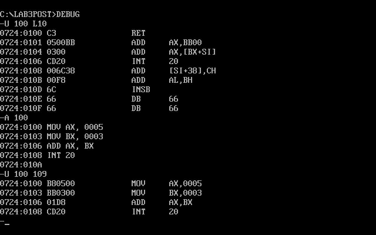
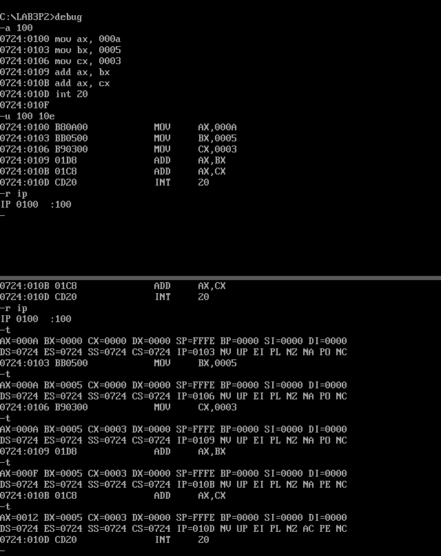
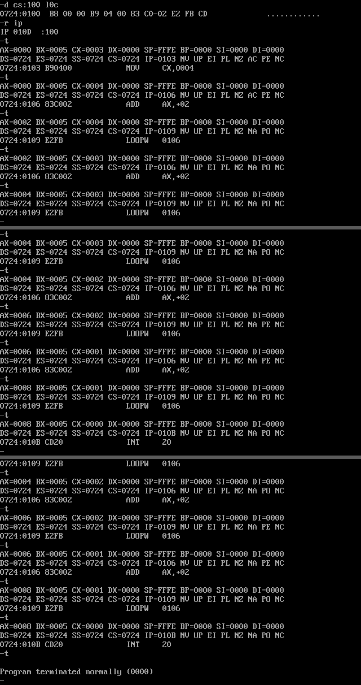
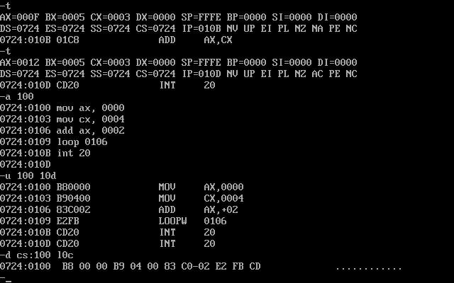
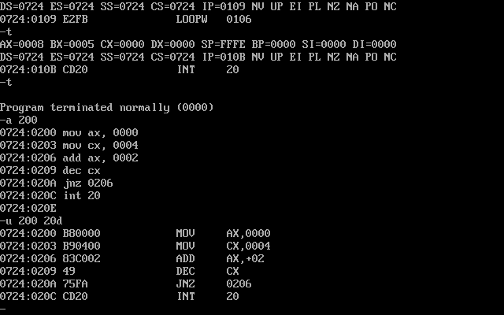
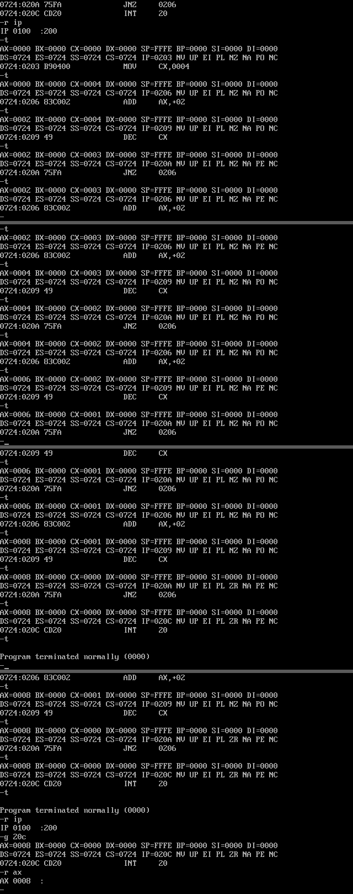

# cobos-post1-u3: Manejo del DEBUG en DOSBox

- **Curso:** Arquitectura de Computadores (1154507-B), Universidad Francisco de Paula Santander
- **Estudiante:** Isabella Cobos Lizarazo (1152507)
- **Unidad 3:** Post-contenido. Exploración, ensamblado y ejecución paso a paso en DOSBox

Este repositorio documenta un laboratorio de dos partes realizado en DOSBox 0.74-3 con el depurador DEBUG. La **Parte 1** inspecciona el estado inicial del procesador y la memoria con los comandos R, F, D, E y U. Termina leyendo con direccionamiento directo a memoria (`MOV AX,[0300]`) un valor escrito antes con E. La **Parte 2** ensambla programas con A, los ejecuta instrucción a instrucción con T y compara un bucle con LOOP frente a su equivalente con DEC/JNZ, además del comando G como verificación rápida.

Todas las capturas se tomaron con la función de captura propia de DOSBox (Ctrl+F5), que guarda la pantalla emulada de 640×400 tal como se ve. Cuando una traza no cabe en las 25 líneas de la pantalla de texto, la captura del checkpoint reúne las pantallas consecutivas de la misma sesión, separadas por una franja gris.

### Estructura del repositorio

```
cobos-post1-u3/
├── README.md
└── capturas/
    ├── CP1_registros.png                 (Parte 1)
    ├── CP2_volcado_memoria.png           (Parte 1)
    ├── CP3_ensamblado_desensamblado.png  (Parte 1)
    ├── CP4_memoria_direccionamiento.png  (Parte 1)
    ├── CP1_traza_suma.png                (Parte 2)
    ├── CP2_traza_loop.png                (Parte 2)
    ├── CP2_codigo_maquina_loop.png       (Parte 2, Paso 8)
    ├── CP3_ensamblado_dec_jnz.png        (Parte 2, Paso 9)
    └── CP3_traza_dec_jnz.png             (Parte 2)
```

### Comandos DEBUG utilizados

| Comando | Uso en el laboratorio |
|---|---|
| `R`, `R AX`, `R IP` | Mostrar todos los registros, o mostrar y modificar uno |
| `F 200 L40 AB CD EF` | Rellenar un rango con un patrón cíclico |
| `D 200 L40`, `D 0 L20`, `D CS:100 L0C` | Volcar memoria en hexadecimal y ASCII |
| `E 300 78 56` | Escribir bytes puntuales |
| `A 100`, `A 200`, `A 320` | Ensamblar instrucciones directamente en memoria |
| `U 100 109`, `U 320 324`, ... | Desensamblar para verificar la codificación |
| `T` | Ejecutar una instrucción y mostrar el estado resultante |
| `G 20C` | Ejecutar a velocidad normal hasta un punto de interrupción |
| `Q` | Salir de DEBUG |

## Parte 1: Exploración con DEBUG en DOSBox

### Entorno utilizado

El laboratorio se ejecutó en DOSBox 0.74-3 sobre Windows, con la carpeta `C:\DOSWork` del equipo anfitrión montada como unidad `C:` virtual y el `DEBUG.EXE` ubicado en la raíz de esa carpeta. Antes de trabajar se cargó la distribución de teclado latinoamericana con `KEYB LA`, porque con la distribución española que DOSBox carga por defecto los caracteres `:`, `[` y `]` no se producían con las teclas esperadas.

```
Z:\> KEYB LA
Z:\> MOUNT C C:\DOSWork
Z:\> C:
C:\> MD LAB3POST1
C:\> CD LAB3POST1
C:\LAB3POST> DEBUG
```

El prompt muestra `C:\LAB3POST>` y no `C:\LAB3POST1>`. DOS solo admite nombres de directorio de hasta 8 caracteres más extensión (formato 8.3), así que DOSBox recorta `LAB3POST1` a `LAB3POST`. Por la misma razón, la Parte 2 se trabajó en `LAB3P2`: `LAB3POST2` también se habría recortado a `LAB3POST` y habría coincidido con el directorio de la Parte 1.

### Checkpoint 1: Estado de registros (comando R)


| Registro | Valor inicial | Observación |
|---|---|---|
| AX, BX, CX, DX | 0000 | Registros de propósito general en cero |
| SP | FFFE | Tope inicial de la pila, al final del segmento de 64 KB |
| BP, SI, DI | 0000 | Sin uso al iniciar |
| DS, ES, SS, CS | 0724 | Los cuatro segmentos apuntan al mismo párrafo, el del PSP que asignó DOS |
| IP | 0100 | Primera dirección ejecutable después de los 256 bytes del PSP |
| Banderas | NV UP EI PL NZ NA PO NC | Todas en su estado de reposo; EI indica interrupciones habilitadas |

El segmento real asignado en esta sesión fue 0x0724, no 0x1357 como en la guía, porque el valor depende de cuánta memoria convencional ya ocupa el DOS emulado. La línea de desensamblado inicial mostró `0724:0100 C3 RET` en lugar de `CD20 INT 20`: al iniciar DEBUG sin archivo, la posición CS:0100 contiene lo que haya quedado en memoria. Después se ejecutó `R AX`, que mostró el valor actual `AX 0000` y aceptó `1234`. La segunda invocación de `R` confirmó que solo AX cambió a 1234 (4660 en decimal) y que el resto del estado del procesador permaneció idéntico.

### Checkpoint 2: Volcado hexadecimal con F y D


Con `F 200 L40 AB CD EF` se rellenaron 64 bytes desde DS:0200, y `D 200 L40` mostró el patrón repetido cíclicamente en las 4 filas. Como 64 no es múltiplo de 3, cada fila empieza en un byte distinto del patrón (AB, CD, EF, AB).

**Columnas de la salida de D.** La primera columna es la dirección lógica del primer byte de la fila en formato `segmento:desplazamiento` (por ejemplo `0724:0200`). La zona central contiene 16 bytes en hexadecimal, separados por un guion entre el octavo y el noveno para facilitar el conteo. La columna derecha muestra los mismos 16 bytes interpretados como ASCII, con un punto en lugar de cada byte no imprimible, que es la razón por la que AB, CD y EF aparecen como puntos. Cada fila avanza 0x10 en el desplazamiento, así que la dirección de cualquier byte se obtiene sumando su posición dentro de la fila a la dirección inicial.

Con `D 0 L20` se exploraron los primeros 32 bytes del PSP. Los dos primeros bytes son `CD 20`, la instrucción INT 20 que DOS coloca al inicio del PSP para que un programa COM que ejecute un RET con la pila vacía termine de forma controlada. Los demás bytes (`FF 9F` como tope de memoria disponible, y la tabla de manejadores de archivo `01 01 01 00 02 FF...` en 0x18) difieren de los de la guía porque reflejan la configuración concreta del DOS emulado.

### Checkpoint 3: Ensamblado con A y desensamblado con U



Primero se ejecutó `U 100 L10` sobre la memoria sin inicializar. DEBUG interpretó como instrucciones bytes que no eran código (por ejemplo `INSB` y `DB 66`), lo que confirma que en modo real no hay distinción entre código y datos: el procesador ejecuta lo que encuentre en CS:IP.

Después se ensambló el programa con `A 100` y se verificó con `U 100 109`:

| Dirección | Bytes | Instrucción | Análisis |
|---|---|---|---|
| 0100 | B8 05 00 | MOV AX,0005 | Opcode B8 + inmediato 0x0005 en little-endian |
| 0103 | BB 03 00 | MOV BX,0003 | Opcode BB + inmediato 0x0003 |
| 0106 | 01 D8 | ADD AX,BX | Opcode 01 /r con ModR/M D8 |
| 0108 | CD 20 | INT 20 | Opcode CD + número de interrupción |

El programa ocupa 10 bytes, igual que en la guía. La diferencia está en `ADD AX,BX`: el DEBUG de esta instalación lo codificó como `01 D8` y no como `03 C3`. Las dos codificaciones son válidas y equivalentes. En x86 la suma registro-registro tiene dos opcodes, 01 (ADD r/m16, r16) y 03 (ADD r16, r/m16), que difieren solo en el bit de dirección. Con `01 D8`, el campo reg de ModR/M (11 011 000) es BX, la fuente, y el campo r/m es AX, el destino. Con `03 C3` los papeles se invierten. El resultado de la ejecución es idéntico, y U lo confirma al mostrar en ambos casos el mismo mnemónico `ADD AX,BX`.

### Checkpoint 4: Modificación de memoria con E y direccionamiento directo


Se limpió la región con `F 300 L10 00`, se verificó con `D 300 L10` (16 bytes en 00) y se escribieron dos bytes con `E 300 78 56`. El segundo `D 300 L10` mostró `78 56 00 00 ...`, con la columna ASCII `xV` porque 0x78 es "x" y 0x56 es "V". Leídos como palabra little-endian, esos dos bytes representan 0x5678.

Luego se ensambló `MOV AX,[0300]` en 0320 con `A 320`, y `U 320 324` confirmó la codificación `A1 00 03`. Con `R IP` se fijó IP en 0320 y se ejecutó `T`. El resultado fue **AX=5678** e IP avanzó a 0323, sobre el `INT 20`. Esto verifica que la instrucción leyó de memoria el valor escrito antes con E.

### Decisión técnica (Paso 12): verificación no destructiva de una escritura en memoria

De los cuatro comandos disponibles, el adecuado para confirmar la escritura del Paso 11 es D. Invocar `E 300` sin lista de bytes no es seguro, porque DEBUG entra en modo interactivo: muestra el valor actual de cada byte y espera una tecla. Cualquier dígito hexadecimal tecleado por error reemplaza el contenido, y la verificación misma se convierte en una nueva escritura. En el Paso 11 E fue apropiado porque recibió la lista completa `78 56` y su intención explícita era modificar. F tampoco sirve para verificar, aunque opere sobre un rango igual que D: su único efecto es escribir un patrón, así que usarlo destruiría precisamente los bytes que se quieren comprobar. R solo muestra o cambia registros y no permite observar DS:0300. D, en cambio, solo lee memoria y la presenta en hexadecimal y ASCII sin alterar ningún byte ni registro. Esa propiedad de solo lectura es la que exige una verificación: el acto de observar no puede cambiar lo observado.

### Decisión técnica (Paso 14): direccionamiento inmediato frente a directo a memoria

Aunque `MOV AX,0005` (B8 05 00) y `MOV AX,[0300]` (A1 00 03) ocupan los mismos 3 bytes, el direccionamiento directo a memoria requiere un ciclo adicional de acceso al bus. En el modo inmediato, el valor 0x0005 viaja dentro del flujo de instrucción y llega al procesador en la misma búsqueda (fetch) que trae el opcode. En el modo directo, los dos bytes que siguen al opcode no son el dato sino una dirección: el procesador forma la dirección física DS×16+0300, en este caso 0x07540, y realiza una lectura adicional para traer la palabra almacenada allí. Aun así, el direccionamiento directo es preferible cuando el objetivo es leer un valor que puede cambiar en tiempo de ejecución, como los bytes 78 56 escritos con E en el Paso 11, que ninguna constante ensamblada podría anticipar. Para saber qué codificación produjo cada comando A no hace falta ejecutar nada: basta con `U 100 102` y `U 320 322`, que muestran los opcodes B8 y A1 junto a su operando y revelan si este es un valor o una dirección.

## Parte 2: Ensamblado y ejecución paso a paso

Los tres programas de esta parte se ensamblaron y trazaron en una sola sesión de DEBUG dentro de `C:\LAB3P2`. Todas las tablas usan los valores reales que mostró la sesión, con el segmento 0724 de esta instalación en lugar del 1357 de la guía.

### Checkpoint 1: Traza del programa de suma



La captura reúne dos pantallas consecutivas de la misma sesión. La primera muestra el ensamblado con `A 100`, la verificación con `U 100 10E` y el ajuste con `R IP` a 0100. La segunda muestra la traza completa con cinco invocaciones de `T`.

| # | Instrucción ejecutada | AX | BX | CX | IP siguiente | ZF | CF | SF |
|---|---|---|---|---|---|---|---|---|
| 1 | MOV AX,000A | 000A | 0000 | 0000 | 0103 | 0 (NZ) | 0 (NC) | 0 (PL) |
| 2 | MOV BX,0005 | 000A | 0005 | 0000 | 0106 | 0 | 0 | 0 |
| 3 | MOV CX,0003 | 000A | 0005 | 0003 | 0109 | 0 | 0 | 0 |
| 4 | ADD AX,BX | 000F | 0005 | 0003 | 010B | 0 | 0 | 0 |
| 5 | ADD AX,CX | **0012** | 0005 | 0003 | 010D | 0 | 0 | 0 |

AX terminó en 0x0012 (18 en decimal), el valor esperado. Las tres instrucciones MOV no modifican las banderas, por eso las tres primeras filas conservan el estado inicial. Después de `ADD AX,BX` la paridad pasó a PE: 0x0F tiene cuatro bits en 1 en su byte bajo, una cantidad par. Después de `ADD AX,CX` se activó la bandera de acarreo auxiliar (AC), porque la suma de los nibbles bajos, F + 3 = 0x12, produjo un acarreo del bit 3 al bit 4. ZF, CF y SF se mantuvieron en 0 durante toda la traza: el resultado nunca fue cero, nunca se desbordó de 16 bits y siempre fue positivo. Igual que en la Parte 1, el DEBUG de esta instalación codificó `ADD AX,BX` como `01 D8` y `ADD AX,CX` como `01 C8`, la forma equivalente de la codificación `03 C3` y `03 C1` que muestra la guía.

### Checkpoint 2: Traza del bucle con LOOP



El programa se ensambló sobre la misma dirección 0100 y se verificó con `U 100 10D`. Con `R IP` se mostró `IP 010D`, porque el programa de suma se había detenido sobre su INT 20 sin ejecutarlo, y se cambió a 0100. La captura reúne las tres pantallas de la traza, con 11 invocaciones de `T` en total.

| Paso T | Iteración | Instrucción | AX después | CX después | IP siguiente | ¿LOOP salta? |
|---|---|---|---|---|---|---|
| 1 | Inicio | MOV AX,0000 | 0000 | 0003 | 0103 | — |
| 2 | Inicio | MOV CX,0004 | 0000 | 0004 | 0106 | — |
| 3 | 1 | ADD AX,+02 | 0002 | 0004 | 0109 | — |
| 4 | 1 | LOOP 0106 | 0002 | 0003 | 0106 | Sí |
| 5 | 2 | ADD AX,+02 | 0004 | 0003 | 0109 | — |
| 6 | 2 | LOOP 0106 | 0004 | 0002 | 0106 | Sí |
| 7 | 3 | ADD AX,+02 | 0006 | 0002 | 0109 | — |
| 8 | 3 | LOOP 0106 | 0006 | 0001 | 0106 | Sí |
| 9 | 4 | ADD AX,+02 | 0008 | 0001 | 0109 | — |
| 10 | 4 | LOOP 0106 | **0008** | **0000** | 010B | No |
| 11 | Fin | INT 20 | — | — | — | Program terminated normally |

Cuando LOOP dejó de saltar, AX valía 0x0008 y CX 0x0000, como pide la verificación. En el paso 1, CX aún mostraba 0003: era el valor que había dejado el programa de suma. Solo cambió a 0004 al ejecutar `MOV CX,0004`, lo que confirma que DEBUG no reinicia los registros al ensamblar un programa nuevo. A lo largo de la traza las banderas no cambian por efecto de LOOP, que no altera ninguna bandera. La única variación es la paridad (PO o PE), que actualiza cada ADD.

### Análisis del código máquina (Paso 8)



`D CS:100 L0C` mostró `B8 00 00 B9 04 00 83 C0-02 E2 FB CD`:

| Bytes | Instrucción | Tamaño | Análisis |
|---|---|---|---|
| B8 00 00 | MOV AX,0000 | 3 | Opcode B8 + inmediato de 16 bits |
| B9 04 00 | MOV CX,0004 | 3 | Opcode B9 + 0x0004 en little-endian |
| 83 C0 02 | ADD AX,+02 | 3 | Opcode 83 /0 con inmediato de 8 bits extendido con signo |
| E2 FB | LOOP 0106 | 2 | Opcode E2 + desplazamiento relativo FB (−5) |
| CD 20 | INT 20 | 2 | Opcode CD + número de interrupción |

Hay dos diferencias reales con la guía. Primera: `ADD AX,0002` se ensambló como `83 C0 02` y no como `05 02 00`. Las dos ocupan 3 bytes; esta codificación guarda el inmediato en un solo byte que el procesador extiende con signo a 16 bits, y por eso U lo muestra como `ADD AX,+02`. Segunda: el programa ocupa 13 bytes, de modo que `L0C` (12 bytes) deja fuera el último byte del `INT 20`, como se ve en la captura, donde la fila termina en `CD`. El desplazamiento de LOOP se calcula respecto a la instrucción siguiente: 0x0106 − 0x010B = −5 = 0xFB. Ese desplazamiento de 8 bits con signo limita los saltos cortos a un rango de −128 a +127 bytes.

### Checkpoint 3: Bucle equivalente con DEC/JNZ y demostración con G





El programa se ensambló en 0200 y `U 200 20D` confirmó `49` para `DEC CX` y `75 FA` para `JNZ 0206` (0x0206 − 0x020C = −6 = 0xFA). La captura de la traza reúne cuatro pantallas: las 15 invocaciones de `T` y, al final, la demostración con `G 20C` seguida de `R AX`.

| Paso T | Iteración | Instrucción | AX después | CX después | IP siguiente | ¿JNZ salta? |
|---|---|---|---|---|---|---|
| 1 | Inicio | MOV AX,0000 | 0000 | 0000 | 0203 | — |
| 2 | Inicio | MOV CX,0004 | 0000 | 0004 | 0206 | — |
| 3 | 1 | ADD AX,+02 | 0002 | 0004 | 0209 | — |
| 4 | 1 | DEC CX | 0002 | 0003 | 020A | — |
| 5 | 1 | JNZ 0206 | 0002 | 0003 | 0206 | Sí (ZF=0) |
| 6 | 2 | ADD AX,+02 | 0004 | 0003 | 0209 | — |
| 7 | 2 | DEC CX | 0004 | 0002 | 020A | — |
| 8 | 2 | JNZ 0206 | 0004 | 0002 | 0206 | Sí (ZF=0) |
| 9 | 3 | ADD AX,+02 | 0006 | 0002 | 0209 | — |
| 10 | 3 | DEC CX | 0006 | 0001 | 020A | — |
| 11 | 3 | JNZ 0206 | 0006 | 0001 | 0206 | Sí (ZF=0) |
| 12 | 4 | ADD AX,+02 | 0008 | 0001 | 0209 | — |
| 13 | 4 | DEC CX | 0008 | 0000 | 020A | — (ZF pasa a 1, ZR) |
| 14 | 4 | JNZ 0206 | **0008** | **0000** | 020C | No (ZF=1) |
| 15 | Fin | INT 20 | — | — | — | Program terminated normally |

En el paso 1, BX y CX aparecen en 0000 y no con los valores del programa anterior. Al ejecutarse `INT 20` en el bucle LOOP, DEBUG informó la terminación y reinició los registros. Esa es también la razón por la que, tras la terminación, `R IP` mostró `IP 0100`. El paso 13 muestra la cadena causal del mecanismo: `DEC CX` lleva CX a cero, activa ZF (la bandera cambia de NZ a ZR) y JNZ lo lee en el paso 14 para no saltar.

**Demostración con G.** Con `R IP` en 0200 y `G 20C`, DEBUG ejecutó el bucle completo a velocidad normal y se detuvo en 0724:020C con AX=0008, CX=0000 y ZR. Luego `R AX` mostró `AX 0008` y se pulsó Enter sin escribir valor, con lo que se confirmó el resultado sin modificar el registro.

**Conteo comparado de instrucciones ejecutadas.**

| Versión | Inicialización | Instrucciones por iteración | Iteraciones | Terminación | Total de T |
|---|---|---|---|---|---|
| LOOP | 2 | 2 (ADD + LOOP) | 4 | 1 | **11** |
| DEC/JNZ | 2 | 3 (ADD + DEC + JNZ) | 4 | 1 | **15** |

La diferencia de 4 instrucciones corresponde exactamente a una instrucción de control adicional por iteración. Es coherente con los bytes de código: el control del bucle ocupa 2 bytes con LOOP (`E2 FB`) y 3 con DEC/JNZ (`49 75 FA`), de modo que el programa con DEC/JNZ ocupa 14 bytes (0200 a 020D) frente a 13 del programa con LOOP.

### Decisión técnica (Paso 10): LOOP frente a DEC/JNZ

Para este bucle contador simple, en el que CX no cumple ninguna otra función dentro del cuerpo, la opción recomendada es LOOP. Su codificación `E2 FB` ocupa 2 bytes frente a los 3 de `DEC CX` + `JNZ` (`49 75 FA`). Además, el procesador extrae y decodifica una sola instrucción de control por iteración en lugar de dos: la traza lo confirmó con 11 invocaciones de T frente a 15 para el mismo resultado, AX = 0x0008. DEC/JNZ sería preferible cuando el cuerpo del bucle necesita CX para otra operación, por ejemplo como contador de desplazamientos con `SHL AX,CL` o en instrucciones de cadena con REP, porque LOOP siempre decrementa CX y lo corrompería. También lo sería cuando la condición de salida no es "CX ≠ 0" sino el resultado de un `CMP` evaluado con cualquier salto condicional, o cuando se quiere contar con otro registro, como `DEC BX`. Para comparar el tamaño no hace falta ejecutar nada: `U 100 10D` y `U 200 20D` listan las direcciones y los bytes de cada instrucción. LOOP aparece como 2 bytes entre 0109 y 010B, mientras que DEC y JNZ suman 3 bytes entre 0209 y 020C.

### Decisión técnica (Paso 12): T frente a G para bucles de muchas iteraciones

Si CX empezara en 0x0064, verificar el resultado con T exigiría unas 300 invocaciones (3 por iteración en la versión DEC/JNZ), cada una con su volcado de registros. `G 20C`, en cambio, ejecuta todo a velocidad normal y se detiene solo en el punto de interrupción, entregando el estado final en un único paso. Lo que se pierde con G es la historia intermedia: no se observa cómo decrece CX, en qué iteración cambia la paridad ni el momento exacto en que DEC activa ZF y JNZ deja de saltar. En este laboratorio, T fue indispensable en los Pasos 4, 7 y 11, porque completar una tabla de traza exige registrar AX, CX, IP y las banderas después de cada instrucción, y solo T se detiene en cada una. G solo habría entregado la última fila de cada tabla. Tras ejecutar `G 20C`, el comando para confirmar únicamente el valor final de AX es `R AX`, pulsando Enter sin escribir un valor nuevo. Así se muestra `AX 0008` sin modificarlo, como quedó registrado en la captura del Checkpoint 3.

## Conclusiones

- DEBUG permite ver la correspondencia directa entre mnemónicos y bytes de código máquina. Una misma instrucción puede tener más de una codificación válida: `ADD AX,BX` salió como `01 D8` y no como `03 C3`, y `ADD AX,0002` como `83 C0 02` y no como `05 02 00`. U es la herramienta para confirmar cuál se generó sin ejecutar nada.
- En modo real no hay separación entre código y datos. U interpretó como instrucciones bytes residuales de la memoria, y E y MOV con direccionamiento directo trabajaron sobre la misma región que D mostraba como datos.
- El orden little-endian se comprobó dos veces: al escribir `78 56` con E y leer AX=5678, y en los inmediatos de 16 bits de cada MOV.
- LOOP y DEC/JNZ producen el mismo resultado (AX=0008), pero LOOP lo logra con un byte y una instrucción menos por iteración: 11 frente a 15 instrucciones ejecutadas. DEC/JNZ sigue siendo necesario cuando CX tiene otro uso o la condición de salida no depende de un contador.
- T y G se complementan. T es imprescindible para construir tablas de traza; G con `R AX` es la forma práctica de verificar el resultado final de bucles largos.
- Los valores concretos dependen del entorno: el segmento 0724, el recorte de nombres de directorio a 8 caracteres y el reinicio de registros que DEBUG hace tras `Program terminated normally`. Por eso todas las tablas registran lo observado en la sesión real y no los valores de referencia de la guía.
